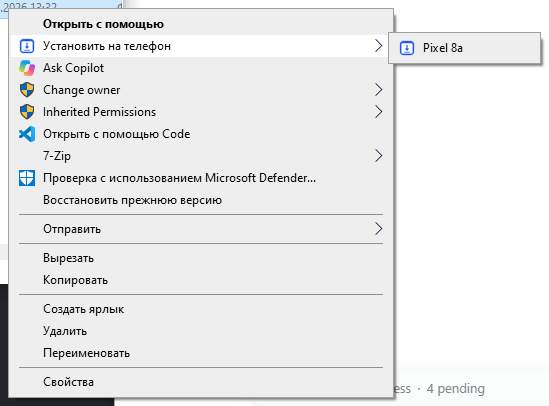

# APK → телефон

Правый клик по любому `.apk` в Проводнике → **«Установить на телефон»** → имя подключённого телефона.
Программа ставит APK через `adb install -r` и показывает результат.

Пункт меню появляется **только когда телефон подключён** — за этим следит иконка в трее.



## Что нужно

| Компонент | Зачем |
|---|---|
| Windows 10 или 11 | Проверено на Windows 10 22H2 |
| .NET 8 Desktop Runtime | Проверить: `dotnet --list-runtimes` → должен быть `Microsoft.WindowsDesktop.App 8.x` |
| `adb.exe` (Android SDK Platform Tools) | Либо в `PATH`, либо путь указывается в настройках |
| Телефон с включённой «Отладкой по USB» | Подтвердить запрос на экране телефона |

## Установка

```powershell
powershell -ExecutionPolicy Bypass -File install.ps1
```

Скрипт:

1. копирует программу в `%LOCALAPPDATA%\ApkToPhone`;
2. прописывает пункт в контекстное меню `.apk` (только для текущего пользователя, **без прав администратора**);
3. добавляет автозапуск при входе в систему;
4. запускает трей.

То же самое можно сделать вручную: скопировать `ApkToPhone.exe` куда угодно и запустить `ApkToPhone.exe setup`.

## Как пользоваться

1. Подключите телефон кабелем, включите «Отладку по USB», подтвердите запрос на телефоне.
2. Правый клик по `.apk` → **Установить на телефон** → выберите устройство.
3. Дождитесь окна с результатом.

Если подключено несколько телефонов, в подменю появится пункт **«Все устройства (N)»**.

### Трей

Иконка рядом с часами:

- **Установить APK на телефон…** — выбрать файл и устройство без Проводника;
- **Обновить меню** — принудительно перестроить пункты;
- **Запускать при входе** — автозапуск;
- **Открыть папку программы**;
- **Настройки (путь к adb)…** — открывает `config.json`;
- **Выход**.

Трей опрашивает `adb devices -l` каждые 4 секунды и при изменении списка устройств перестраивает меню
и уведомляет Проводник (`SHChangeNotify`), так что перезапуск Проводника не нужен.

## Настройки

`%LOCALAPPDATA%\ApkToPhone\config.json`

```json
{
  "adbPath": "",
  "installArguments": ""
}
```

- `adbPath` — полный путь к `adb.exe`, если его нет в `PATH` и в стандартных местах
  (`%LOCALAPPDATA%\Android\Sdk\platform-tools`, `C:\adb`, `C:\platform-tools`, …).
- `installArguments` — дополнительные ключи `adb install`, например `-d` (разрешить понижение версии)
  или `-g` (выдать все разрешения сразу).

## Удаление

```powershell
powershell -ExecutionPolicy Bypass -File uninstall.ps1
```

`-KeepFiles` — оставить файлы программы, убрав только меню и автозапуск.

## Как устроено

- `HKCU\Software\Classes\SystemFileAssociations\.apk\shell\ApkToPhone` — сам пункт меню
  (`MUIVerb`, `Icon`, `ExtendedSubCommandsKey = ApkToPhone.Devices`).
- `HKCU\Software\Classes\ApkToPhone.Devices\shell\devN` — по подпункту на каждое устройство,
  команда: `"…\ApkToPhone.exe" install --serial "<serial>" "%1"`.
- Установка — `adb -s <serial> install -r <apk>`; вывод adb разбирается и переводится в понятный текст
  (`INSTALL_FAILED_UPDATE_INCOMPATIBLE`, `INSTALL_FAILED_USER_RESTRICTED` и т. п.).
- Запись только в `HKCU`, файлы — в `%LOCALAPPDATA%`, поэтому установка не требует администратора.

На Windows 11 пункты из реестра попадают в старое меню — «Показать дополнительные параметры» (Shift+F10).

## Сборка из исходников

```powershell
dotnet publish -c Release
powershell -ExecutionPolicy Bypass -File install.ps1
```

Результат: `bin\Release\net8.0-windows\win-x64\publish\ApkToPhone.exe` (один файл, ~230 КБ).
Иконка генерируется скриптом `tools/make_icon.py` (Pillow).

## Если что-то не так

| Симптом | Что делать |
|---|---|
| Пункта нет в меню | Трей не запущен → запустите `ApkToPhone.exe` из `%LOCALAPPDATA%\ApkToPhone` или нажмите «Обновить меню» в трее |
| «Телефон не подключён» | Проверьте кабель, режим передачи файлов и «Отладку по USB» |
| «Нет доступа к телефону» | Подтвердите запрос «Разрешить отладку по USB» на экране телефона |
| `INSTALL_FAILED_UPDATE_INCOMPATIBLE` | На телефоне стоит версия с другой подписью — удалите её и повторите |
| `INSTALL_FAILED_USER_RESTRICTED` | В настройках разработчика включите «Установка через USB» |
| Не найден adb | Пропишите путь в `config.json` → `adbPath` |
